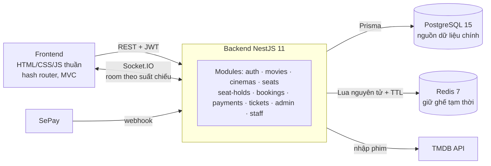

# STI Cinema Ticket DN

Hệ thống đặt vé xem phim trực tuyến cho các rạp tại **Đà Nẵng**: tổng hợp phim, rạp, suất chiếu, phòng, ghế, giá vé, đặt vé, thanh toán và vé điện tử (QR) trên một nền tảng, phục vụ cả người dân và khách du lịch.

## Điểm nổi bật

- **Giữ ghế tạm thời bằng Redis TTL (5 phút).** Việc giữ/nhả ghế chạy bằng script Lua nên nguyên tử: hai người cùng bấm một ghế thì chỉ một người giữ được; không ai nhả được ghế của người khác. PostgreSQL vẫn là nguồn dữ liệu chính, ghế chỉ thành `BOOKED` sau khi thanh toán thành công.
- **Sơ đồ ghế cập nhật thời gian thực bằng Socket.IO**, mỗi suất chiếu một room. Sự kiện chỉ mang `showtimeId`; client tải lại sơ đồ qua API nên không lộ thông tin người đang giữ ghế.
- **Thanh toán SePay an toàn khi gọi lặp.** Webhook xác thực API key, đối chiếu tài khoản nhận và số tiền; giao dịch trùng không phát hành vé lần hai. Booking, payment, ghế và vé được cập nhật trong một transaction Prisma.
- **Xác thực nhiều lớp.** Access token JWT 10 phút, refresh token xoay vòng theo phiên (dùng lại token cũ sẽ thu hồi cả phiên), `authVersion` vô hiệu mọi phiên khi đổi mật khẩu, rate limit đăng nhập, quên mật khẩu qua email. Phân quyền `CUSTOMER` / `STAFF` / `ADMIN`; danh tính luôn lấy từ phiên, không tin `userId` từ client.
- **Quy trình soát vé** cho nhân viên/quản trị bằng mã QR, kèm quản lý ca làm và chấm công.
- **Quản trị:** phim (nhập từ TMDB), cụm rạp, phòng, bố cục ghế, suất chiếu (kiểm tra trùng giờ), giá vé, combo, khuyến mãi, thống kê.

Quy mô: **26 bảng** PostgreSQL, khoảng **97 endpoint** REST có tài liệu Swagger, **105 test tự động** (46 unit + 59 e2e).

## Kiến trúc

Modular monolith: Controller → Service → Prisma. Không dùng microservice hay hạ tầng phân tán.



Luồng khách hàng: duyệt phim → chọn rạp/suất → xem sơ đồ ghế → giữ ghế → đăng nhập/đăng ký → tạo booking → thanh toán → nhận vé QR → xem lịch sử vé.

| Thành phần | Công nghệ |
|---|---|
| Backend | NestJS 11, TypeScript, class-validator, Swagger |
| Cơ sở dữ liệu | PostgreSQL 15, Prisma 5 |
| Giữ ghế | Redis 7 (TTL, script Lua) |
| Thời gian thực | Socket.IO |
| Frontend | HTML5, CSS3, JavaScript thuần (không framework) |
| Thanh toán | SePay (webhook), thanh toán demo |
| Dữ liệu phim | TMDB API |
| Vận hành | Docker Compose, GitHub Actions |

Sơ đồ quan hệ cơ sở dữ liệu: [docs/erd.md](docs/erd.md) (tự sinh từ Prisma schema). Thiết kế chi tiết: [docs/database-design.md](docs/database-design.md), [docs/auth-redesign.md](docs/auth-redesign.md).

## Chạy nhanh bằng Docker

Yêu cầu: Docker và Docker Compose.

```bash
cp .env.example .env
# Điền JWT_ACCESS_SECRET (>= 32 ký tự), ví dụ: openssl rand -hex 32
docker compose up --build
```

- Giao diện: http://localhost:5173
- API: http://localhost:3000/api — Swagger: http://localhost:3000/api/docs

Backend tự áp migration khi khởi động. Nạp dữ liệu mẫu Đà Nẵng (tài khoản, rạp, phim, suất chiếu):

```bash
docker compose exec -w /app backend npx prisma db seed
```

Chỉ chạy PostgreSQL và Redis để phát triển local: `docker compose up -d postgres redis`.

## Chạy khi phát triển

```bash
npm install                                  # thư mục gốc: Prisma
npm install --prefix backend
cp .env.example .env                         # điền JWT_ACCESS_SECRET
docker compose up -d postgres redis
npx prisma migrate dev
npx prisma db seed
npm run start:dev --prefix backend           # API tại :3000
cd frontend && npx vite --host 0.0.0.0       # giao diện tại :5173
```

Gửi email đặt lại mật khẩu cần Gmail App password (`MAIL_USER`, `MAIL_PASSWORD` trong `.env`); thiếu cấu hình thì luồng vẫn trả 202 nhưng không gửi thư. Thanh toán SePay xem [docs/sepay-setup.md](docs/sepay-setup.md).

## Kiểm thử

```bash
cd backend
npm run build
npm test            # unit test
npm run test:e2e    # e2e: Prisma/Redis giả lập, Socket.IO kết nối thật
```

Test tích hợp trên PostgreSQL và Redis thật: `npm run test:integrity`. CI (GitHub Actions) chạy kiểm tra schema, build, unit, e2e và build image Docker cho mỗi pull request.

## Tài khoản seed (chỉ dùng khi phát triển)

- Admin: `admin@cinema.test` / `123123123`
- Staff: `staff@cinema.test` / `123123123`
- Customer: `customer@cinema.test` / `123123123`

Không dùng các tài khoản này ngoài môi trường phát triển.
