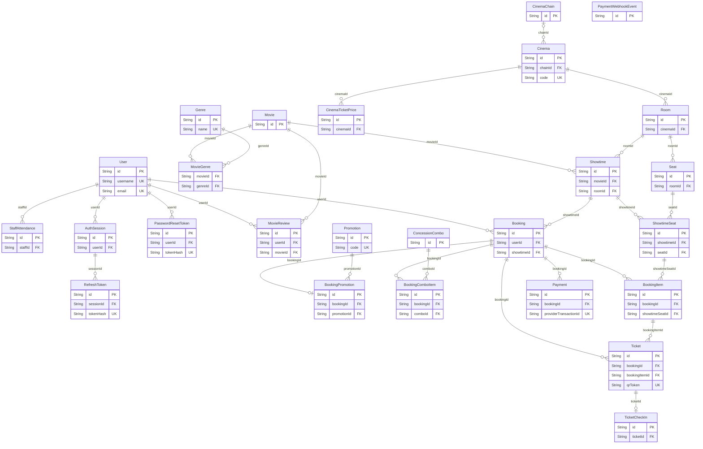

# ERD

> Tự sinh từ `prisma/schema.prisma` bằng `node scripts/generate-erd.js`. Chỉ hiển thị khóa chính (PK), khóa ngoại (FK) và cột duy nhất (UK); danh sách cột đầy đủ xem [database-schema-excel.csv](database-schema-excel.csv).

