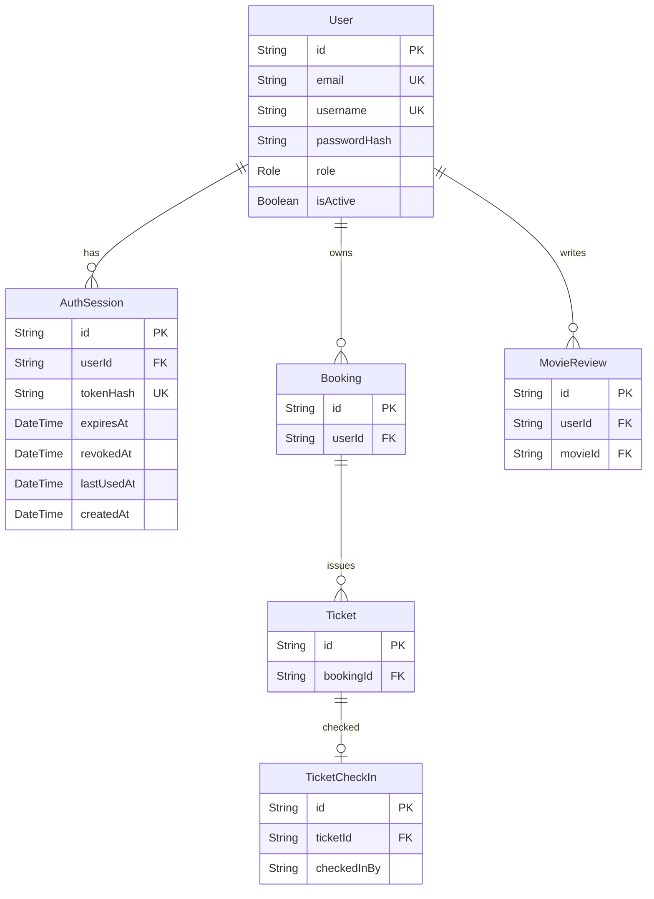

# 1. Problems Found

- `RefreshToken` thực chất lưu opaque bearer session; tên model/table gây hiểu nhầm. Đã có bcrypt, token ngẫu nhiên và SHA-256 từ trước, không có lỗi lưu raw token được phát hiện.
- AdminGuard và StaffGuard lặp bearer parsing, hashing, lookup, expiry và inactive-user checks.
- Thiếu logout thu hồi phiên ở server và endpoint lấy danh tính hiện tại.
- Profile, lịch sử booking/vé và tạo review tin userId từ client.
- API chi tiết/hủy booking, combo, promotion, payment, payment-status và vé thiếu kiểm tra chủ sở hữu.
- QR lookup/check-in công khai; checkedInBy lấy từ body.
- API đọc mọi booking và kích hoạt dọn booking công khai.
- Register chưa xử lý race unique constraint thành 409; tạo user và phiên đầu tiên chưa nằm trong cùng transaction.
- Mapper public user và tách họ tên bị lặp giữa auth/profile/admin.

**Xung đột phạm vi chưa giải quyết:** seat-holds vẫn nhận body/query.userId để nhận diện chủ giữ ghế; seat map nhận query.userId để tính heldByMe. Yêu cầu đồng thời cấm sửa seat-holds, trừ khi cần compile Auth. Vì vậy giữ nguyên miền này và đã hỏi riêng về việc mở phạm vi sửa lớp HTTP. Không thể đánh dấu hoàn tất tiêu chí “toàn backend không còn tin userId từ client” khi ngoại lệ này còn tồn tại.

# 2. Architecture Implemented

Giữ modular monolith NestJS và opaque bearer token.

- **Authentication:** AuthGuard parse đúng một bearer token; AuthService hash SHA-256, tìm AuthSession + User, kiểm tra revokedAt, expiresAt và isActive. Request nhận user an toàn và session ID, không có passwordHash/tokenHash.
- **Authorization:** RolesGuard chỉ đọc req.user.role và metadata @Roles; không parse token hoặc truy vấn phiên. Admin chỉ ADMIN; chấm công chỉ STAFF; soát vé STAFF hoặc ADMIN.
- **Ownership:** CurrentUser truyền ID phiên riêng với DTO vào service. Customer routes không có admin bypass. Booking owner được đối chiếu trước khi trả dữ liệu/thay đổi trạng thái; promotion kiểm tra ngay trong transaction sẵn có.
- **Session lifecycle:** token ngẫu nhiên 32 byte, thời hạn cố định 7 ngày như trước, chỉ lưu hash. lastUsedAt được ghi có điều kiện tối đa mỗi 5 phút. Logout chỉ đặt revokedAt cho phiên hiện tại, thiết bị khác tiếp tục hoạt động. Vai trò và trạng thái tài khoản được đọc lại mỗi request.
- **Registration:** email trim/lowercase trước validation; bcrypt cost 10; role luôn CUSTOMER. Password tối thiểu 6 ký tự, tối đa 72 byte UTF-8, dùng chung cho register/login/tạo staff. User và phiên đầu tiên cùng transaction; unique race trả 409.
- **Reuse:** common/public-user.ts là nguồn chuẩn của public-user mapping và tách tên. Mapper publicStaff giữ riêng vì hợp đồng admin trả role enum và tập trường khác. Loader vé dùng chung, nhưng kiểm tra ownership customer và quyền staff vẫn tách ranh giới.

Các transaction thanh toán, Redis/Lua/TTL, thuật toán ghế và kiến trúc payment được giữ nguyên. SePay callback tiếp tục dùng xác thực provider bằng API key sẵn có; không thay bằng bearer session.

# 3. ERD After Refactor



Role vẫn là enum CUSTOMER/STAFF/ADMIN. checkedInBy là trường string hiện hữu, nay nhận ID actor đã xác thực, không bổ sung bảng phân quyền hoặc thay schema check-in.

# 4. Database Migration

Migration: `prisma/migrations/20260908000000_rename_auth_sessions/migration.sql`.

- RENAME table refresh_tokens → auth_sessions tại chỗ.
- Đổi tên primary key, foreign key, unique index và hai index userId/expiresAt cho khớp Prisma.
- Thêm lastUsedAt nullable; không backfill giả lịch sử truy cập.
- Chạy trong BEGIN/COMMIT; không DROP/recreate dữ liệu phiên.
- Seed đổi sang prisma.authSession. Không chạy seed reset dữ liệu dự án.

Đã replay toàn bộ lịch sử SQL trên PostgreSQL **18.6** tạm, kiểm tra bảo toàn active/revoked/expired sessions, tokenHash, dates, unique constraint, FK và cascade. AuthSession khớp schema Prisma. Chưa chạy trên PostgreSQL 15.

Đối chiếu toàn schema phát hiện lệch **có từ trước**: migration init có ShowtimeSeatStatus.BLOCKED nhưng schema hiện tại không có. Không áp SQL diff loại bỏ enum vì ngoài phạm vi auth và có thể ảnh hưởng dữ liệu ghế.

**Chưa áp migration vào database dự án.** Khi triển khai, dừng phiên bản backend cũ, chạy `npx prisma migrate deploy`, generate/build và khởi động bản mới. Không chạy lẫn backend cũ dùng refresh_tokens với backend mới sau rename. Phiên đang có vẫn dùng được vì hash, trạng thái và thời hạn không thay đổi.

# 5. Files Changed

| File | Change | Reason |
|---|---|---|
| [backend/package-lock.json](../backend/package-lock.json) | Thêm types bcryptjs | Kiểm tra kiểu auth đầy đủ |
| [backend/package.json](../backend/package.json) | Thêm types bcryptjs | Kiểm tra kiểu auth đầy đủ |
| [backend/src/admin/admin.controller.ts](../backend/src/admin/admin.controller.ts) | Guard/CurrentUser và route an toàn | Chặn giả mạo caller/actor |
| [backend/src/admin/admin.guard.ts](../backend/src/admin/admin.guard.ts) | Xóa guard cũ | Loại bỏ authentication trùng lặp |
| [backend/src/admin/admin.module.ts](../backend/src/admin/admin.module.ts) | Import/export AuthModule, wire controllers | Dependency injection đúng |
| [backend/src/admin/admin.service.ts](../backend/src/admin/admin.service.ts) | Dùng splitName chuẩn | Không lặp quy tắc tách tên |
| [backend/src/admin/dto/admin.dto.ts](../backend/src/admin/dto/admin.dto.ts) | Bỏ danh tính client hoặc dùng password policy | Không tin identity đầu vào |
| [backend/src/auth/auth.controller.ts](../backend/src/auth/auth.controller.ts) | AuthGuard/RolesGuard/decorators/types/API/DTO | Authentication và authorization tách biệt |
| [backend/src/auth/auth.module.ts](../backend/src/auth/auth.module.ts) | AuthGuard/RolesGuard/decorators/types/API/DTO | Authentication và authorization tách biệt |
| [backend/src/auth/auth.service.spec.ts](../backend/src/auth/auth.service.spec.ts) | Thêm/cập nhật regression tests | Xác minh auth, ownership, migration |
| [backend/src/auth/auth.service.ts](../backend/src/auth/auth.service.ts) | Session lookup/revoke/touch, transaction register | Lifecycle an toàn |
| [backend/src/auth/decorators/current-user.decorator.ts](../backend/src/auth/decorators/current-user.decorator.ts) | AuthGuard/RolesGuard/decorators/types/API/DTO | Authentication và authorization tách biệt |
| [backend/src/auth/decorators/roles.decorator.ts](../backend/src/auth/decorators/roles.decorator.ts) | AuthGuard/RolesGuard/decorators/types/API/DTO | Authentication và authorization tách biệt |
| [backend/src/auth/dto/login.dto.ts](../backend/src/auth/dto/login.dto.ts) | AuthGuard/RolesGuard/decorators/types/API/DTO | Authentication và authorization tách biệt |
| [backend/src/auth/dto/password.decorator.ts](../backend/src/auth/dto/password.decorator.ts) | Validation bcrypt 6 ký tự/72 byte | Một policy dùng chung |
| [backend/src/auth/dto/register.dto.ts](../backend/src/auth/dto/register.dto.ts) | AuthGuard/RolesGuard/decorators/types/API/DTO | Authentication và authorization tách biệt |
| [backend/src/auth/guards/auth.guard.ts](../backend/src/auth/guards/auth.guard.ts) | AuthGuard/RolesGuard/decorators/types/API/DTO | Authentication và authorization tách biệt |
| [backend/src/auth/guards/roles.guard.ts](../backend/src/auth/guards/roles.guard.ts) | AuthGuard/RolesGuard/decorators/types/API/DTO | Authentication và authorization tách biệt |
| [backend/src/auth/types/authenticated-user.type.ts](../backend/src/auth/types/authenticated-user.type.ts) | AuthGuard/RolesGuard/decorators/types/API/DTO | Authentication và authorization tách biệt |
| [backend/src/bookings/admin-bookings.controller.ts](../backend/src/bookings/admin-bookings.controller.ts) | Guard/CurrentUser và route an toàn | Chặn giả mạo caller/actor |
| [backend/src/bookings/bookings.controller.ts](../backend/src/bookings/bookings.controller.ts) | Guard/CurrentUser và route an toàn | Chặn giả mạo caller/actor |
| [backend/src/bookings/bookings.module.ts](../backend/src/bookings/bookings.module.ts) | Import/export AuthModule, wire controllers | Dependency injection đúng |
| [backend/src/bookings/bookings.service.spec.ts](../backend/src/bookings/bookings.service.spec.ts) | Thêm/cập nhật regression tests | Xác minh auth, ownership, migration |
| [backend/src/bookings/bookings.service.ts](../backend/src/bookings/bookings.service.ts) | Owner checks, actor riêng, loader vé dùng chung | Chặn truy cập booking người khác |
| [backend/src/bookings/dto/check-in-ticket.dto.ts](../backend/src/bookings/dto/check-in-ticket.dto.ts) | Bỏ danh tính client hoặc dùng password policy | Không tin identity đầu vào |
| [backend/src/bookings/dto/create-booking.dto.ts](../backend/src/bookings/dto/create-booking.dto.ts) | Bỏ danh tính client hoặc dùng password policy | Không tin identity đầu vào |
| [backend/src/bookings/ticket-checkins.controller.ts](../backend/src/bookings/ticket-checkins.controller.ts) | Guard/CurrentUser và route an toàn | Chặn giả mạo caller/actor |
| [backend/src/bookings/tickets.controller.ts](../backend/src/bookings/tickets.controller.ts) | Guard/CurrentUser và route an toàn | Chặn giả mạo caller/actor |
| [backend/src/common/public-user.ts](../backend/src/common/public-user.ts) | Mapper public user + tách tên chuẩn | Loại bỏ helper trùng |
| [backend/src/movies/dto/movie-review.dto.ts](../backend/src/movies/dto/movie-review.dto.ts) | Bỏ danh tính client hoặc dùng password policy | Không tin identity đầu vào |
| [backend/src/movies/movies.controller.ts](../backend/src/movies/movies.controller.ts) | Guard/CurrentUser và route an toàn | Chặn giả mạo caller/actor |
| [backend/src/movies/movies.module.ts](../backend/src/movies/movies.module.ts) | Import/export AuthModule, wire controllers | Dependency injection đúng |
| [backend/src/movies/movies.service.ts](../backend/src/movies/movies.service.ts) | Review userId truyền riêng từ session | Giữ paid-booking/unique review rule |
| [backend/src/staff/staff.controller.ts](../backend/src/staff/staff.controller.ts) | Guard/CurrentUser và route an toàn | Chặn giả mạo caller/actor |
| [backend/src/staff/staff.guard.ts](../backend/src/staff/staff.guard.ts) | Xóa guard cũ | Loại bỏ authentication trùng lặp |
| [backend/src/staff/staff.module.ts](../backend/src/staff/staff.module.ts) | Import/export AuthModule, wire controllers | Dependency injection đúng |
| [backend/src/users/users.controller.ts](../backend/src/users/users.controller.ts) | Guard/CurrentUser và route an toàn | Chặn giả mạo caller/actor |
| [backend/src/users/users.module.ts](../backend/src/users/users.module.ts) | Import/export AuthModule, wire controllers | Dependency injection đúng |
| [backend/src/users/users.service.ts](../backend/src/users/users.service.ts) | Dùng mapper chung, xử lý đúng lỗi P2025 | Hồ sơ an toàn và lỗi đúng nghĩa |
| [backend/test/auth.e2e-spec.ts](../backend/test/auth.e2e-spec.ts) | Thêm/cập nhật regression tests | Xác minh auth, ownership, migration |
| [backend/test/verify-auth-migration.py](../backend/test/verify-auth-migration.py) | Thêm/cập nhật regression tests | Xác minh auth, ownership, migration |
| [backend/test/verify-auth-session.cjs](../backend/test/verify-auth-session.cjs) | Thêm/cập nhật regression tests | Xác minh auth, ownership, migration |
| [docs/database-design.md](../docs/database-design.md) | Đồng bộ mô tả session/ERD | Không giữ tài liệu auth sai nghĩa |
| [docs/database-relationships.csv](../docs/database-relationships.csv) | Đồng bộ mô tả session/ERD | Không giữ tài liệu auth sai nghĩa |
| [docs/database-schema-excel.csv](../docs/database-schema-excel.csv) | Đồng bộ mô tả session/ERD | Không giữ tài liệu auth sai nghĩa |
| [docs/identity-auth-refactor.md](../docs/identity-auth-refactor.md) | Báo cáo 10 phần | Ghi rõ kiểm chứng và giới hạn |
| [prisma/migrations/20260908000000_rename_auth_sessions/migration.sql](../prisma/migrations/20260908000000_rename_auth_sessions/migration.sql) | Rename table/constraints, thêm lastUsedAt | Giữ dữ liệu phiên |
| [prisma/schema.prisma](../prisma/schema.prisma) | AuthSession + User.authSessions | Semantics session đúng |
| [prisma/seed.js](../prisma/seed.js) | Dùng prisma.authSession | Tương thích generated client |

# 6. API Changes

Mọi endpoint dưới đây có prefix `/api`.

| Method | Old endpoint | New endpoint | Auth rule |
|---|---|---|---|
| POST | /auth/register | Giữ nguyên | Public; role CUSTOMER, validated DTO |
| POST | /auth/login | Giữ nguyên | Public; bcrypt + active user |
| POST | — | /auth/logout | AuthGuard; revoke current session |
| GET | — | /auth/me | AuthGuard; session user |
| PATCH | /users/:userId/profile | /users/me | AuthGuard; own profile |
| GET | /users/:userId/bookings | /users/me/bookings | AuthGuard; own history |
| GET | /users/:userId/tickets | /users/me/tickets | AuthGuard; own paid tickets |
| GET | /bookings (all users) | /bookings (own user) | AuthGuard; own history |
| GET | /bookings (all users) | /admin/bookings | ADMIN; monitoring |
| POST | /bookings/expire | /admin/bookings/expire | ADMIN |
| POST | /bookings | Giữ nguyên | AuthGuard; userId lấy từ session |
| GET, DELETE | /bookings/:bookingId | Giữ nguyên | AuthGuard + owner |
| PATCH | /bookings/:bookingId/combos | Giữ nguyên | AuthGuard + owner |
| PATCH | /bookings/:bookingId/promotion | Giữ nguyên | AuthGuard + owner trong transaction |
| POST | /bookings/:bookingId/pay, /sepay | Giữ nguyên | AuthGuard + owner |
| GET | /bookings/:bookingId/payment-status, /tickets | Giữ nguyên | AuthGuard + owner |
| GET | /tickets/qr/:qrToken | Giữ nguyên | STAFF hoặc ADMIN |
| GET | /bookings/qr/:bookingQrToken | Giữ nguyên | STAFF hoặc ADMIN |
| POST | /tickets/qr/:qrToken/check-in | Giữ nguyên | STAFF hoặc ADMIN; actor từ session |
| POST | /bookings/qr/:bookingQrToken/check-in | Giữ nguyên | STAFF hoặc ADMIN; actor từ session |
| GET | /movies/:movieId/reviews?userId=... | /movies/:movieId/reviews | Public; không suy ra caller từ query |
| GET | — | /movies/:movieId/reviews/me | AuthGuard; eligibility/current review của session |
| POST | /movies/:movieId/reviews | Giữ nguyên | AuthGuard; paid-booking rule, rating 1–10, một user/movie |
| ALL | /admin/* | Giữ nguyên | AuthGuard + RolesGuard(ADMIN) |
| ALL | /staff/* | Giữ nguyên | AuthGuard + RolesGuard(STAFF) |
| GET | /bookings/payment-methods | Giữ nguyên | Public |
| POST | /bookings/sepay-webhook | Giữ nguyên | Provider authentication sẵn có |

Customer xem QR/vé của mình qua lịch sử vé và booking tickets; QR lookup bất kỳ là nghiệp vụ staff/admin. Các route userId cũ bị gỡ, trả 404. Whitelist bỏ trường thừa userId/role/checkedInBy; các trường này không xác định caller hay actor.

Các service VNPay/demo chưa có route controller ở baseline được giữ lại, bổ sung tham số owner bắt buộc cho thao tác khởi tạo payment. Không mở endpoint mới cho chúng.

Frontend không được chỉnh sửa; client cũ cần cập nhật endpoint và bearer header trong task riêng.

# 7. Authorization Matrix

| Resource | CUSTOMER | STAFF | ADMIN |
|---|---|---|---|
| Public catalog/showtimes/prices/reviews | Có | Có | Có |
| Profile, /auth/me, logout | Phiên mình | Phiên mình | Phiên mình |
| Booking CRUD/combo/promotion/payment | Booking mình | Booking mình | Booking mình |
| Customer booking/ticket history | Của mình | Của mình | Của mình |
| Review create/update | Có booking PAID | Có booking PAID | Có booking PAID |
| QR lookup/check-in | Không | Có | Có |
| Admin APIs/all-booking monitoring/expiry | Không | Không | Có |
| Staff attendance | Không | Chấm công mình | Không |

Customer routes không có ngoại lệ cho ADMIN thao tác booking của người khác. Admin monitoring nằm ở namespace riêng.

# 8. Tests

**Passed**

- Prisma format, validate, generate.
- Backend build.
- 8 unit suites: **28 tests**.
- 2 e2e suites: **56 tests** (55 identity/authorization HTTP tests và 1 AppModule smoke).
- Auth HTTP tests dùng controller, AuthGuard, RolesGuard, AuthService, UsersService và BookingsService thật; Prisma/Redis được mock. Check-in/booking-create dùng spy để xác minh delegation danh tính; review dùng MoviesService thật.
- Bao phủ register, duplicate email, email normalization, role injection, bcrypt, hash-only token, password byte limit, login username/email, wrong password, inactive user, missing/malformed/unknown token, expired/revoked session, me, logout current device, lastUsedAt throttling.
- Bao phủ CUSTOMER→admin/staff bị 403, STAFF→admin bị 403, ADMIN→admin được phép; legacy profile/history không còn hoạt động; injected userId không thay caller.
- Bao phủ foreign booking detail/cancel/tickets/payment-status/combo/promotion/pay/SePay bị từ chối; check-in CUSTOMER bị 403, STAFF/ADMIN được phép và dùng actor từ session.
- Unit test unique race thành 409 và user/session cùng transaction.
- PostgreSQL thật: register/login/hash lookup/logout/multiple devices/inactive-user rejection/cascade, hai đăng ký đồng thời chỉ tạo một user/session và request còn lại nhận 409.
- Migration replay, bảo toàn dữ liệu và constraints.
- Lint riêng auth, mapper chung, admin-bookings controller và HTTP auth tests: **0 errors, 0 warnings**.
- git diff --check; kiểm tra không sửa frontend/Redis/seat-holds.

**Failed**

Lint toàn repository còn **401 errors, 18 warnings**. Đã so với nội dung HEAD cho các file lớn có sửa: admin.controller 52→52, admin.service 108→108, bookings.service.spec 13→13, bookings.service 206→201. Các file lỗi còn lại không thuộc thay đổi này. Không chạy lint --fix toàn repo để tránh sửa ngoài phạm vi.

**Not run**

- Migration trên PostgreSQL 15 hoặc database dự án.
- Demo UI end-to-end với frontend (ngoài phạm vi).

Lệnh tái lập:

```bash
npx prisma format
npx prisma validate
npx prisma generate
npm --prefix backend run build
npm --prefix backend run test -- --runInBand
npm --prefix backend run test:e2e -- --runInBand
# Database test riêng; script tạo schema ngẫu nhiên và tự dọn, không đọc .env ứng dụng.
AUTH_MIGRATION_TEST_URL='postgresql://USER@HOST:PORT/TEST_DB' python3 backend/test/verify-auth-migration.py
git diff --check
```

# 9. Remaining Risks

- **Seat-hold identity vẫn tin userId client:** hold/release có thể nhận danh tính chủ hold giả mạo. Cần cho phép sửa lớp HTTP để dùng optional AuthSession, đồng thời giữ guest sessionId và giữ nguyên Redis/Lua/TTL. Đây là ngoại lệ trực tiếp do giới hạn phạm vi, chưa được xử lý.
- Login/register chưa có rate limiting chống brute force.
- Password policy 72-byte mới có thể từ chối mật khẩu dài mà bcrypt cũ đã âm thầm cắt ngắn; tài khoản legacy như vậy cần quy trình đổi mật khẩu nếu tồn tại.
- Chưa có tác vụ dọn phiên hết hạn/revoked; guard vẫn từ chối các phiên đó chính xác.

# 10. Git Diff Summary

Đổi mô hình phiên và migration bảo toàn dữ liệu; hợp nhất authentication/authorization; thêm current-user/me/logout; enforce ownership ở các API customer thuộc phạm vi; tách admin monitoring/expiry; bảo vệ QR check-in; bổ sung tests và tài liệu.

Chỉ thêm dev dependency @types/bcryptjs cho thư viện hiện có. Không JWT, không frontend, không Redis redesign, không đổi payment architecture. **Không commit.**

Definition of Done đạt cho auth/profile/booking/review/ticket/admin/staff. Tiêu chí toàn backend không tin userId vẫn bị chặn bởi ngoại lệ seat-holds đã nêu; không tuyên bố hardening toàn backend hoàn tất tuyệt đối.
